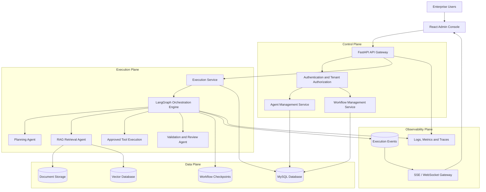

# Enterprise AI Agent Orchestrator

**Repository:** `enterprise-ai-agent-orchestrator`

## 1. Product Overview

### What is the product?

Enterprise AI Agent Orchestrator is a centralized platform for defining, managing, executing, coordinating, monitoring, and evaluating AI agents within an enterprise environment.

The platform enables organizations to build specialized AI agents and connect them into multi-agent workflows to automate complex business and engineering tasks.

For example, a software engineering workflow can involve:

- **Planner Agent:** Understands requirements and breaks tasks into smaller activities.
- **Repository Analyst Agent:** Analyzes existing code and project structure.
- **Coding Agent:** Implements the required changes.
- **Testing Agent:** Executes tests and identifies issues.
- **Review Agent:** Reviews code quality, security, and maintainability.

The orchestrator coordinates these agents, manages execution state, handles failures, and provides visibility into the complete workflow.

### Product Vision

To provide a secure, scalable, and extensible enterprise platform where multiple AI agents can collaborate, execute complex workflows, and deliver measurable business outcomes.

### Core Product Objectives

1. Centralized management of AI agents and workflows.
2. Secure multi-tenant architecture with strict organizational data isolation.
3. Stateful multi-agent orchestration and coordination.
4. Enterprise knowledge integration through Retrieval-Augmented Generation (RAG).
5. Reliable execution with checkpointing, retries, and failure recovery.
6. Real-time execution monitoring and event streaming.
7. AI usage tracking, observability, and cost management.
8. Standardized evaluation of AI agents, particularly coding assistants.

## 2. Core Product Capabilities

| Capability | Description |
|---|---|
| Tenant Workspaces | Isolated organizational workspaces, users, and permissions. |
| Agent Registry | Create, configure, version, and manage AI agents. |
| Workflow Management | Define workflows, dependencies, conditional paths, and agent interactions. |
| Multi-Agent Orchestration | Coordinate specialized agents to complete complex tasks. |
| Execution Management | Manage workflow lifecycle, execution state, retries, and cancellation. |
| Checkpointing | Persist workflow state and support recovery from failures. |
| Knowledge Management | Ingest, extract, chunk, and index enterprise documents. |
| RAG | Retrieve relevant, tenant-authorized enterprise knowledge. |
| Guardrails | Validate prompts, inputs, outputs, and tool permissions. |
| Real-Time Streaming | Stream execution events, agent progress, and token responses. |
| Usage & Cost Tracking | Monitor token consumption, model usage, latency, and estimated costs. |
| Evaluation Framework | Benchmark and evaluate AI agent performance. |
| Observability & Audit | Track executions, errors, logs, metrics, and audit history. |

## 3. High-Level System Architecture

The platform follows a modular, asynchronous architecture with four major logical layers.

### 3.1 Control Plane

Responsible for managing the platform configuration and organizational resources.

Components:
- Tenant and workspace management
- User authentication and authorization
- Agent registry and version management
- Workflow definitions and configurations
- Role-based access control
- Execution policies

### 3.2 Execution Plane

Responsible for running and coordinating AI agents and workflows.

Components:
- Workflow execution service
- LangGraph orchestration engine
- Agent coordination and routing
- Model and LLM integrations
- Approved tool execution
- Retry, timeout, and cancellation handling
- Checkpoint and state management

### 3.3 Data Plane

Responsible for storing and retrieving enterprise knowledge and execution data.

Components:
- MySQL relational database
- Document storage
- Vector database
- Embedding generation
- RAG retrieval services
- Workflow checkpoints
- Execution artifacts

### 3.4 Observability Plane

Responsible for providing visibility into platform operations and execution behavior.

Components:
- Structured application logs
- Execution events
- Metrics and tracing
- Token and cost tracking
- Audit history
- SSE and WebSocket streaming

## 4. High-Level Architecture Diagram



## 5. Technology Architecture

| Technology | Responsibility |
|---|---|
| Python 3.12 | Backend development |
| FastAPI | REST APIs and application services |
| Pydantic v2 | Data validation and configuration |
| SQLAlchemy 2 Async | Asynchronous database access |
| MySQL 8+ | Relational data persistence |
| Yoyo Migrations | Database schema migrations |
| LangChain Core | LLM, message, and tool abstractions |
| LangGraph | Stateful multi-agent orchestration |
| Vector Database | Embedding storage and semantic retrieval |
| React | Frontend administration console |
| TypeScript | Frontend type safety |
| Module Federation | Modular frontend architecture |
| SSE | Server-to-client event streaming |
| WebSockets | Bidirectional real-time communication |
| Pytest | Backend testing |
| Cypress | Frontend end-to-end testing |
| Docker | Application containerization |
| GitHub Actions | CI/CD automation |

## 6. Multi-Tenant Data Architecture

The platform is designed around organizational data ownership and strict tenant isolation.

```text
Organization
    |
    └── Tenant
         |
         ├── Members and Roles
         |
         ├── Agents
         │    └── Agent Versions
         |
         ├── Workflows
         │    └── Workflow Nodes
         |
         ├── Executions
         │    ├── Execution Events
         │    └── Checkpoints
         |
         ├── Knowledge Base
         │    ├── Documents
         │    ├── Chunks
         │    └── Embeddings
         |
         └── Evaluation
              ├── Benchmark Tasks
              └── Evaluation Results
```

### Tenant Isolation Principles

- Every tenant-owned resource must be associated with a tenant.
- Tenant identity must be derived from authenticated user context.
- API requests must validate tenant membership and permissions.
- Database queries must enforce tenant-level filtering.
- Vector retrieval must only return authorized tenant documents.
- Workflow checkpoints and execution events must remain tenant-scoped.
- Streaming subscriptions must validate tenant and execution ownership.
- Cross-tenant access must be prevented at service and repository levels.

## 7. Workflow Execution Architecture

Each workflow is represented as a stateful graph containing specialized agents and execution nodes.

A shared workflow state maintains:

- Tenant ID and execution ID
- Workflow ID and version
- Current execution node
- Input parameters
- Intermediate agent results
- Tool execution records
- Retry and timeout information
- Execution status
- Final output or failure details

LangGraph manages workflow transitions, agent coordination, conditional execution, and parallel branches.

Checkpoint persistence enables supported workflows to recover from interruptions without unnecessarily repeating completed operations.

External side effects must use idempotency controls before automatic retries are enabled.

## 8. Enterprise Knowledge and RAG Architecture

The platform integrates enterprise knowledge sources into agent execution through Retrieval-Augmented Generation.

**Document ingestion flow:**

1. Upload or connect enterprise documents.
2. Validate and extract document content.
3. Split content into manageable chunks.
4. Generate embeddings.
5. Store embeddings in a vector database.
6. Retrieve relevant information based on agent queries.
7. Apply tenant and permission filters.
8. Provide authorized context to the executing agent.

This allows agents to generate context-aware responses using organizational knowledge rather than relying exclusively on model training data.

## 9. Execution Monitoring and Observability

Every workflow execution receives a unique execution identifier.

The platform tracks:

- Workflow execution status
- Individual agent status
- Agent inputs and outputs, subject to data redaction policies
- Tool execution details
- Execution duration
- Model and token usage
- Estimated execution cost
- Errors and retry attempts
- Checkpoint and recovery information

Durable execution events are delivered to the frontend through SSE or WebSockets.

This provides users with real-time visibility into agent activities and workflow progress.

## 10. Coding Assistant Evaluation Framework

The platform includes a standardized evaluation capability for measuring coding assistant performance.

Evaluation process:

1. Create a benchmark task.
2. Pin the repository revision.
3. Provide task instructions and constraints.
4. Execute the coding assistant.
5. Collect generated code changes and artifacts.
6. Run functional tests.
7. Perform static analysis and type checks.
8. Run security checks.
9. Perform architecture and maintainability review.
10. Generate an evaluation report.

Evaluation dimensions include:

- Functional correctness
- Architecture and maintainability
- Security
- Type safety
- Test quality
- Performance
- Documentation

Each evaluation stores model version, prompt version, repository revision, task configuration, test results, and execution evidence to support reproducible comparisons.

## 11. Product Security and Reliability Principles

The platform follows these architectural principles:

- **Security First:** Authentication, authorization, tenant isolation, and controlled tool access.
- **Modular Design:** Independently maintainable services and components.
- **Asynchronous Execution:** Support long-running AI workflows without blocking API requests.
- **Fault Tolerance:** Retries, timeouts, checkpointing, and recovery.
- **Observability:** Traceable execution identifiers, events, logs, and metrics.
- **Scalability:** Support increasing tenants, agents, workflows, and concurrent executions.
- **Extensibility:** Support additional LLM providers, tools, agents, and workflow types.
- **Cost Awareness:** Track model usage, token consumption, and execution costs.

## 12. Product Summary

Enterprise AI Agent Orchestrator is a secure, multi-tenant enterprise platform that provides centralized management and execution of AI agents and multi-agent workflows.

Its architecture combines FastAPI, LangGraph, LangChain, MySQL, vector-based retrieval, and React to deliver stateful orchestration, enterprise knowledge integration, real-time monitoring, and standardized AI agent evaluation.

**The primary goal is to establish a reliable enterprise control plane for AI agents, enabling organizations to build, coordinate, monitor, and evaluate intelligent automation workflows at scale.**